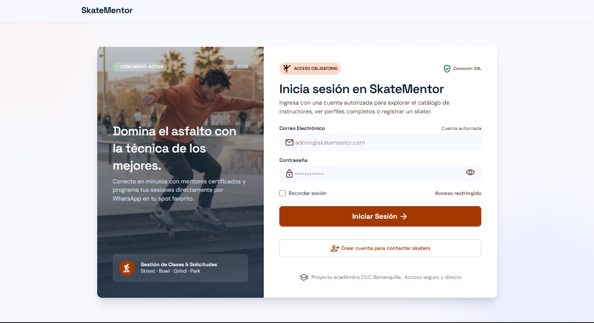
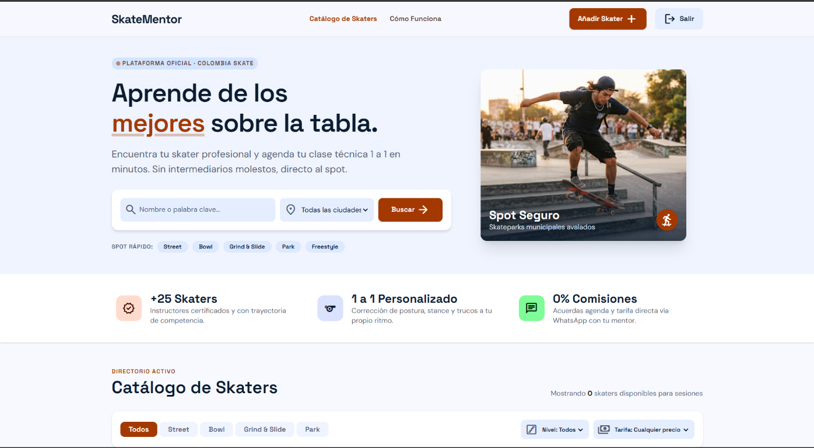
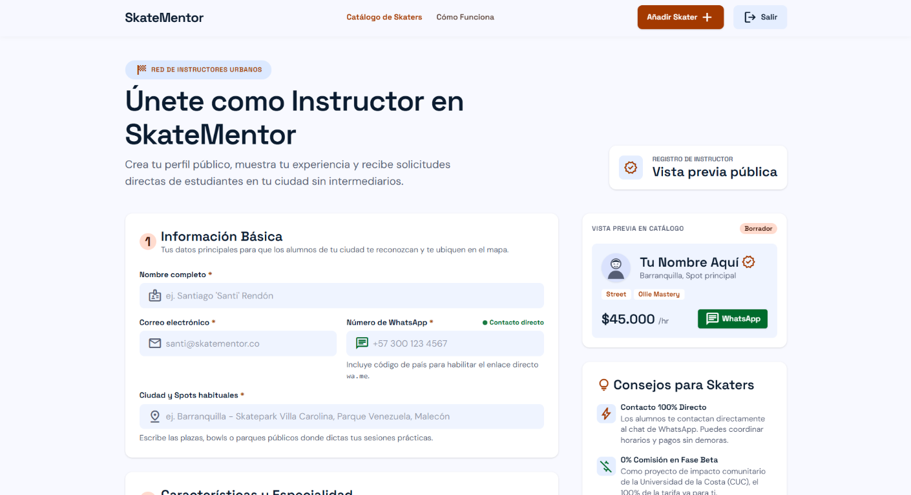

# SkateMentor 🛹

Plataforma web para encontrar skaters que ofrecen clases y contactarlos directamente.


## Sobre el proyecto

SkateMentor permite explorar perfiles de instructores de skate, consultar sus disciplinas, experiencia y tarifa por sesión, y contactarlos por WhatsApp. No incluye pagos ni reservas dentro de la aplicación.

Es un proyecto académico de Buenas Prácticas de Desarrollo de Software de la Universidad de la Costa (CUC), realizado por Vidal Niebles Cáceres y Mateo Pérez Núñez.

## Funcionalidades

- Catálogo de skaters con búsqueda por nombre, ciudad, nivel y modalidad.
- Perfiles completos con experiencia, preferencias de clase, galería, reseñas y contacto.
- Registro de nuevos perfiles para cuentas administrativas.
- Cuentas públicas para contactar y publicar reseñas como alumno.
- Verificación y reseñas administrativas.
- Avatar predeterminado para perfiles y reseñas.
- Clip opcional de presentación en formato MP4 o WebM.
- Almacenamiento local de perfiles, reseñas y clips en el navegador.

## Tecnologías

- Next.js 16 y React 19.
- TypeScript.
- Tailwind CSS.
- Node.js y npm.
- Exportación estática con `output: "export"`.
- GitHub Actions para construir y desplegar.
- AWS EC2 para servir la aplicación y S3 para los recursos estáticos de Next.js.

> Actualmente no existe conexión activa con MySQL ni carga dinámica de fotos o videos a S3. Los perfiles y reseñas creados desde la interfaz se guardan en `localStorage`; los clips se guardan en IndexedDB del navegador. Por eso esos datos no se comparten entre dispositivos.

## Arquitectura actual

El proyecto se construye como una aplicación estática. GitHub Actions genera la carpeta `out/`, sincroniza los recursos `out/_next` con S3 y copia el HTML al servidor EC2.

```text
Usuario
   │
   ▼
EC2 ── sirve el HTML exportado
 │
 └── S3 ── recursos estáticos de Next.js (/_next)

Navegador
 ├── localStorage ── perfiles, cuentas, reseñas y preferencias
 └── IndexedDB ───── clips locales de los skaters
```

La integración futura con MySQL, autenticación segura y almacenamiento compartido en S3 requerirá reemplazar la exportación estática por un backend persistente.

## Estructura de carpetas

```text
skatementor/
├── .github/workflows/       # Flujo de construcción y despliegue
├── app/                     # Páginas, componentes y datos de Next.js
├── lib/                     # Autenticación y almacenamiento local de clips
├── public/                  # Recursos públicos, incluido el avatar predeterminado
├── docs/evidencias/         # Capturas de la aplicación
├── next.config.ts           # Configuración de exportación estática
├── package.json             # Scripts y dependencias
└── README.md
```

## Instalación local

```bash
git clone https://github.com/mateofernando862-hash/skatementor.git
cd skatementor
npm install
npm run dev
```

Abre <http://localhost:3000>.

Para validar la compilación de producción:

```bash
npm run build
```

## Evidencias de funcionamiento

### Inicio de sesión



### Catálogo de skaters



### Registro de nuevo skater



## Equipo

| Integrante | Programa |
| --- | --- |
| Vidal Niebles Cáceres | Ingeniería de Sistemas |
| Mateo Pérez Núñez | Ingeniería de Sistemas |

**Docente:** Kelly Villa Collazos  
**Institución:** Universidad de la Costa (CUC)  
**Año:** 2026
